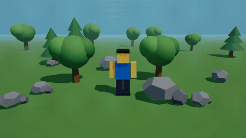

# In This World

**A fully offline cinematic story-video studio.** Build scenes, animate characters, narrate with local TTS, score with bundled music, and export MP4 — all on your own machine. No account, no cloud, no telemetry.

## Demo

> Full-quality video: [`render.mp4`](render.mp4) (MP4, ~2.3 MB). The clip above was rendered entirely inside the engine: 3 scenes, multiple camera shots, offline TTS narration, bundled music, exported with the bundled FFmpeg pipeline on a 2 GB RAM laptop.

## Features

- **Cinematic viewport** — orbit, frame and preview camera shots; transform characters and props with gizmos.
- **Cast & characters** — built-in blocky characters and monsters, plus a character builder to color, shape and save your own cast.
- **Offline narration** — local TTS voices (Piper when available, Windows SAPI otherwise), cached to disk. No cloud voices, ever.
- **Music & SFX** — bundled tracks and effects, per-scene mixing, ducking for narration.
- **Timeline & storyboard** — drag-and-drop scenes, clips, shots and animations; scrub the whole story.
- **MP4 export** — render frames locally and encode with bundled FFmpeg (H.264, AAC, faststart, optional SRT).
- **Optional Director AI** — bring your own OpenAI-compatible endpoint for shot/scene suggestions. Disabled by default; key stays in OS secure storage.
- **Private by design** — core is 100% offline. Projects live in your `userData` folder.

## System requirements

| | |
|---|---|
| OS | Windows · macOS · Linux |
| RAM | 2 GB minimum (4 GB recommended) |
| Storage | ~400 MB installed |
| GPU | WebGL-capable (any modern) |
| Network | Not required for core |
| Export | MP4 · H.264 · AAC · SRT |

## Download

**Coming soon.** The first public build is on its way. The installer will be fully offline, as always.

## License

All rights reserved.
